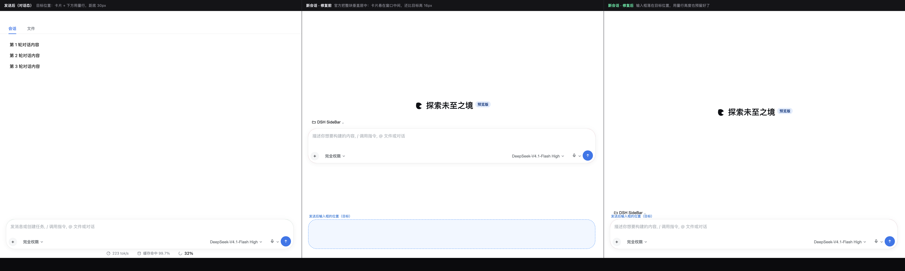
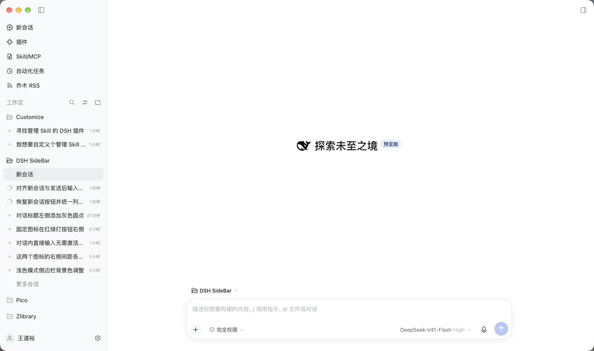

# dsh-plugin-composer-align

把「新会话」页的输入框钉到**和发送消息后完全相同的位置** —— 同宽、同高、同一个 y，
发出去、以及用量行出现时都不再位移。



（预览页 `preview/composer-align.html` 由 `tools/build-composer-align-preview.mjs` 在本地生成 ——
**不随仓库分发**，页面内联了 DSH 官方样式表，生成方式见「自检」一节的第 0 步；
断言在 [`tools/verify-composer-align.mjs`](tools/verify-composer-align.mjs)。）

## 一句话

官方在新会话态把「大标题 + 工作区行 + 输入卡片」整块**垂直居中**（`justify-content:center`），
发出第一条消息后相位变成对话态，输入卡片落到窗口底部 —— 输入框因此会跳大约 380px；
此外新会话态的写字区比对话态高 16px（52px vs 36px），卡片底距也差一条**用量行**的高度（26px）。
本插件只加一张样式表，把新会话态直接套进对话态的那套几何。

## 实测（1600×1000 的窗口，单位 CSS px）

| | 卡片 x | 卡片 y | 尺寸 | 距身体区底边 |
|---|---|---|---|---|
| 修复前 · 新会话 | 320.5 | 494 | 952×114 | 392 |
| 修复前 · 对话（有用量行） | 320.5 | 872 | 952×98 | 30 |
| **修复后 · 新会话** | **320.5** | **872** | **952×98** | **30** |
| 修复后 · 对话（有用量行） | 320.5 | 872 | 952×98 | 30 |
| 修复后 · 对话（用量行空着） | 320.5 | 872 | 952×98 | 30 |

写字区（`[data-composer-input]`）同步：修复前新会话 948×52、对话 948×36；修复后两态都是
948×36，位置逐像素相同。真机复核见下。

## 它到底改了什么（6 条）

官方 `@deepseek-ai/dsh-client-ui-conversation` 的两态差异只有四处，插件逐条抹平：

| # | 官方行为 | 插件的做法 |
|---|---|---|
| ① | hero 态 `scrollBody{justify-content:center}` 把整块居中 | 改 `flex-start`，交给 ② 让座位吃掉整个高度 |
| ② | hero 态座位 `flex:none`，只占内容高 | 座位 `flex:1 1 auto`，撑满身体区 |
| ③ | hero 态输入栈 `padding-bottom:32px`、`gap:8px` | 去掉 32px 底距（卡片离底 32px 的来源）；`gap` **不动**（卡片是栈的最后一个孩子，改它只会白挪上方内容） |
| ④ | HeroShell 是 `height:100%`，在自动高父级里等于内容高 | 显式 `height:auto` + `flex:1 1 0`，让它吸掉上方余量 —— 大标题因此仍在余量里垂直居中，工作区行和卡片一起到底部 |
| ⑤ | hero 态输入行 `padding-bottom:0`（对话态是 4px） | 补成 4px，卡片底边与对话态对齐 |
| ⑥ | hero 态写字区 `min-height:52px`（对话态 36px） | 取 36px —— 这是卡片高 16px 的唯一来源 |
| ⑦ | 卡片下方那条 **composer dock**：对话态里是「tokens/s · 缓存命中」+ 上下文计量表（26px），新会话态官方 `display:none`（0px） | 把 dock 的最小高度钉在 26px 并恢复显示：有内容时本来就是 26px（对话态几何**完全不变**），没内容时留着空白 |

第 ⑦ 条是「一模一样」的最后一块：**用量行没有显示时也留着这段间距**，所以输入框在
「新会话 → 发出第一条消息 → 用量行出现」整个过程中一动不动。按用户要求，空白就空着。

## 为什么是「一个样式表」而不是「一个组件」

新会话的这套组合属于 conversation shell，唯一被支持的替换方式是接管
`conversation.composer` 这条 chain 槽位 —— 代价是丢掉官方 InputBar 和它内部的所有座位
（附件、指令、权限、模型、用量…）。样式表把这些都留着：最坏的失败模式是「选择器不再命中，
输入框退回居中」，永远不会把输入框弄坏。纯 CSS，无构建步骤。

## 选择器为什么这么写

DSH 的类名都是 CSS-module 哈希（`ST7X_W_composerHero`、`yhfFVG_hero`），每次构建都变，
不能用。这里只用 shell 自己声明的 data 属性：

```
[data-conversation-content] / [data-content-phase]   对话身体区
[data-conversation-scroll]                           滚动列
[data-composer-seat]                                 输入区座位
[data-composer-card]                                 输入卡片
[data-composer-input]                                写字区
```

输入栈（composerStack）自己没有属性，所以按**角色**定位：在座位里，它是唯一「包含输入卡片、
但卡片不是它直接子节点」的盒子 —— 后半句同时把输入行（`conversation.composer.bar`，卡片
正是它的直接子节点）排除掉。渲染器的槽位包装（`SlotOutlet` → `[data-slot]`、chain 兜底 →
`[data-chain-overlay-fallback]`）也按名字排除：它们都在栈的**上方**且是 `display:contents`，
排除它们不改变任何布局，但不排除的话，`conversation.composer.bar` 的包装也会命中这个角色，
「取第一个孩子」的规则就会落到输入行而不是大标题上（输入行会长高，卡片停在半空）。

第 ⑦ 条指的是**卡片的最后一个兄弟节点**；它和相位无关，所以在两种相位下都生效 ——
这正是「用量行空着也保留间距」所需要的。

所有选择器都要求 `:has()`（Chrome 105+ / Safari 15.4+）；若某天运行时不支持，规则整体不命中，
输入框退回官方的居中，不会有更坏的后果。

## 安装

插件目录就是本目录。两种装法**二选一**，不要同时启用（会插入两行同名插件）：

```bash
# 本地目录（本仓库 clone 下来之后）
dsh plugin --profile desktop add "link:$PWD"

# 或直接从 GitHub
dsh plugin --profile desktop add "github:daoyu1993-lab/dsh-plugin-composer-align"
```

它会把这个包加进 profile 的 `dependencies` 与 `dsh.profile.bundles`，并在 `node_modules/` 下
建一个指向本目录的**软链接**（登记的是 `link:` 依赖，`pnpm install` 不会把它清掉）。
应用运行中也能安装；**装完刷新页面（⌘R）即可生效**，首次安装若没有热同步就重启一次 App。

另一种装法是把插件作为一个**已解析的包**，由 profile 自己的补丁层装载：
`$DSH_HOME/profiles/desktop/cordis.patch.yml` 末尾的 insert 行即装载点，`dsh-hmr` 会实时拾取
补丁文件的改动（不需要重启）。两种别同时用。

## 生效时机

- **改插件源码（`client.js`）**：client 插件有热更新接收端，保存后**刷新页面即可**；本次实测
  甚至是免刷新直接生效（`window.__ModuleLoader__` 的模块图在补丁行激活时会重建）。
- **改 / 增 profile 补丁行**：`dsh-hmr` 实时拾取，不需要重启。

## 卸载 / 回滚

```bash
# A 路线：删掉 profile 补丁里那段 insert（以及 package.json 的依赖与软链）
rm ~/.dsh/profiles/desktop/node_modules/dsh-plugin-composer-align
```

profile 补丁有备份：`cordis.patch.yml.bak-*`、`package.json.bak-*`。

## 自检（可复现）

```bash
cd <本仓库根目录>
NODE="$(command -v node || echo '/Applications/DeepSeek Harness.app/Contents/Resources/runtime/primary-runtime/dependencies/node/bin/node')"

# 0) 前置：本仓库只分发**截图**，不含官方产物片段（core/、preview/*.css、preview/*.html
#    都在 .gitignore 里）。断言用的夹具从本机 DSH 现场抽出来：
"$NODE" tools/asar-extract.cjs ./core \
  /dsh/node_modules/@deepseek-ai/dsh-client-ui-conversation/ \
  /dsh/node_modules/@deepseek-ai/dsh-client-ui-chat/ \
  /dsh/node_modules/@deepseek-ai/dsh-client-ui-theme/
T=core/dsh/node_modules/@deepseek-ai
"$NODE" tools/extract-css.mjs $T/dsh-client-ui-theme/lib/client.js preview/theme.css
"$NODE" tools/extract-css.mjs $T/dsh-client-ui-theme/lib/client.js preview/palette.css --only design_platform_css_default

# 1) 真样式表 + 真 DOM 复刻的逐像素断言（19 项）
"$NODE" tools/verify-composer-align.mjs

# 2) 生成 / 重画预览
"$NODE" tools/build-composer-align-preview.mjs
"$NODE" tools/screenshot-preview.mjs composer-align
```

`tools/verify-composer-align.mjs` 用的不是手写几何：样式表逐字取自
`@deepseek-ai/dsh-client-ui-conversation` 与 `@deepseek-ai/dsh-client-ui-chat` 的产物，
标记类名一旦改名就**硬失败**；插件样式表是把 `client.js` 放进沙箱**真的跑一遍 `apply(ctx)`**
再从它插入的 `<style>` 里读回来的（顺带验证模块信封、注入与卸载）。DOM 复刻带渲染器的
`display:contents` 槽位包装，并且**同一套断言再跑一遍去掉包装的扁平 DOM**，避免规则其实
依赖了包装层数。

断言里带负例：修复前的两态必须不同（否则测试本身失效），对话态（用户拿来对齐的那个位置）
必须**一字未动**，空 dock 的对话态必须与有用量时同位。

## 真机复核（desktop profile，1470×870 的窗口）

用系统截图对同一个窗口的前后两张图做像素定位（蓝色发送键的中心）：

| | 发送键中心 |
|---|---|
| 对话态（有用量行） | x=2480.5, y=1629.5 |
| 新会话（修复后） | **x=2480.5, y=1629.5** |
| 新会话（修复前） | x=2480.5, y=1681.5 |

修复前差 52 设备像素（26 CSS px，正好是用量行的高度），修复后完全一致。

修复后的新会话页（真实窗口截图，输入框下方那条空白就是用量行的预留位）：



## 已知取舍

- **用量行留白**：新会话页底部会有 26px 的空白（就是将来用量行的位置）。这是用户明确要的：
  「即使没有用量显示，也可以空着，但不要去掉这部分间距」。
- **对话态若 dock 完全为空**（`performanceUsage` 关掉且没有上下文计量表时），输入框会比官方
  默认高 22px —— 但正好等于用量行出现后的位置，所以反而消除了官方自己的那一次位移。
  带用量行的对话态（本 profile 的常态）几何与官方逐像素相同。
- **dock 里若出现更高的内容**（例如别的插件往 `conversation.composer.dock` 里塞面板），
  卡片仍会被顶高 —— 那是内容占位，不是输入框的定位，新会话页没有这类内容可对齐。
- 只改视觉层：不注册槽位、不读别的插件 DOM、不动任何官方组件。

## 目录

```
index.js               宿主半边（空实现：本插件只作用于浏览器）
client.js              浏览器半边：一张样式表，ctx.effect 挂载/卸载
cordis.patch.yml       bundle 装法用的 insert 行
package.json           清单（dsh.bundle.patch + dsh.client）
preview/               预览图与预览页
tools/                 断言与预览生成脚本（见「自检」）
LICENSE                MIT
```
